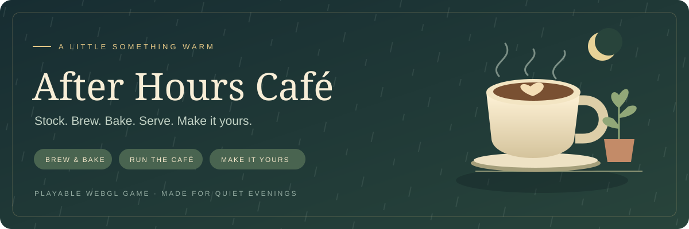
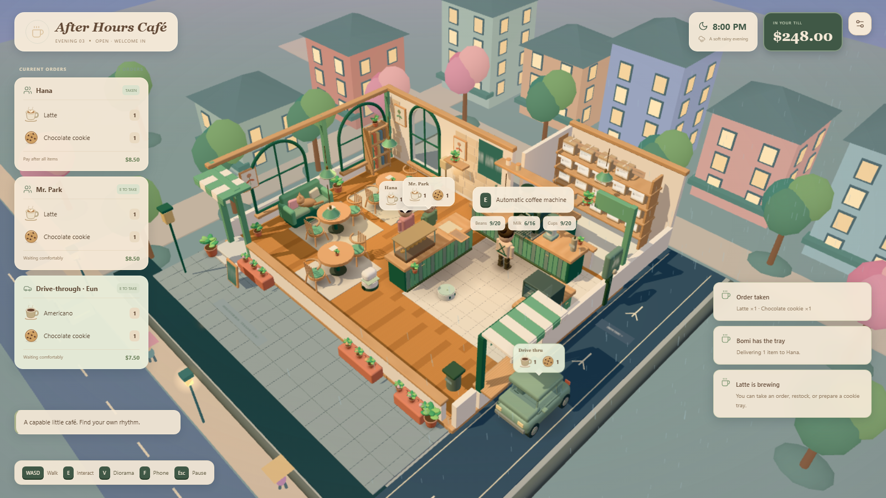
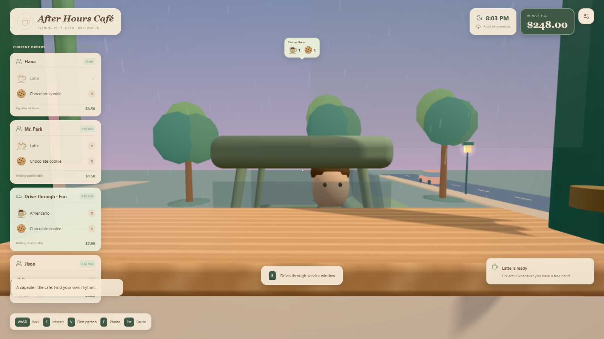
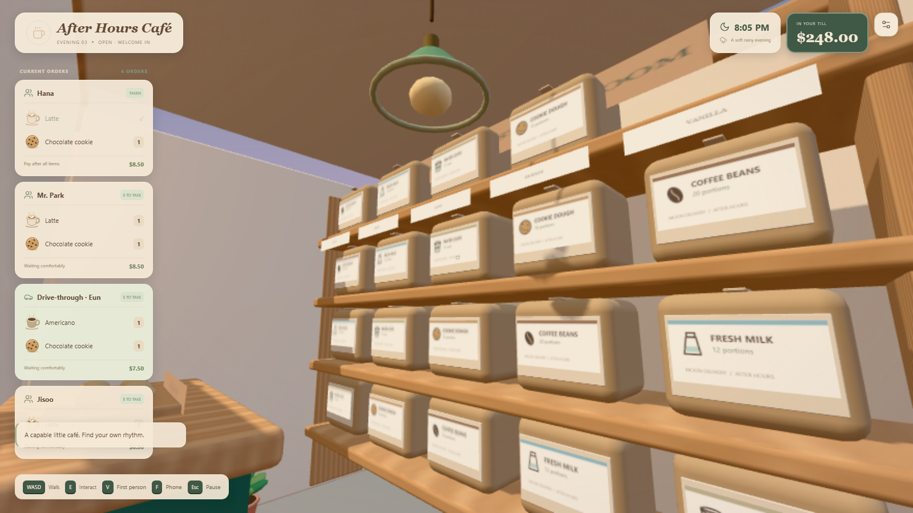
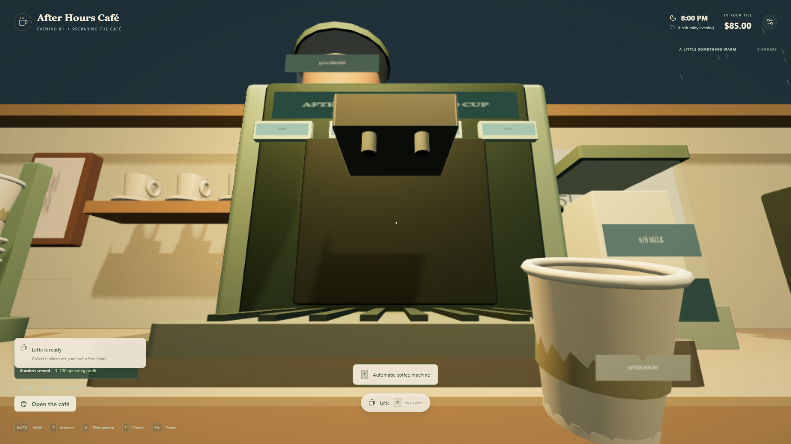
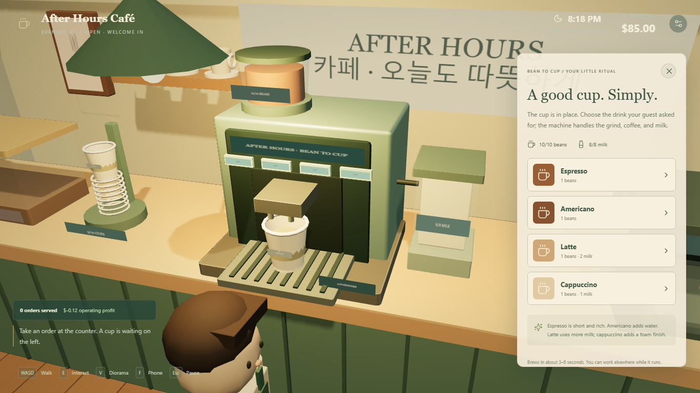
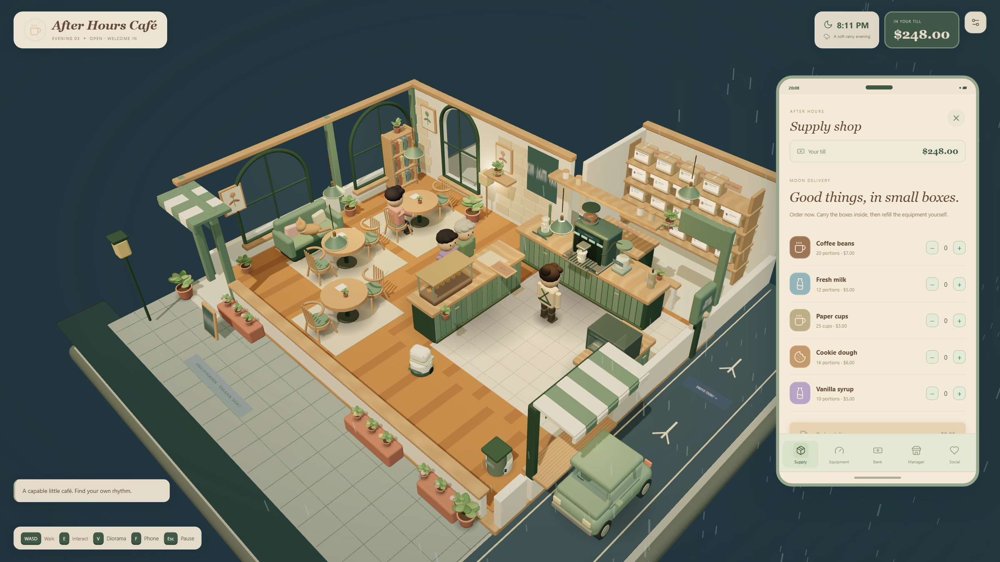
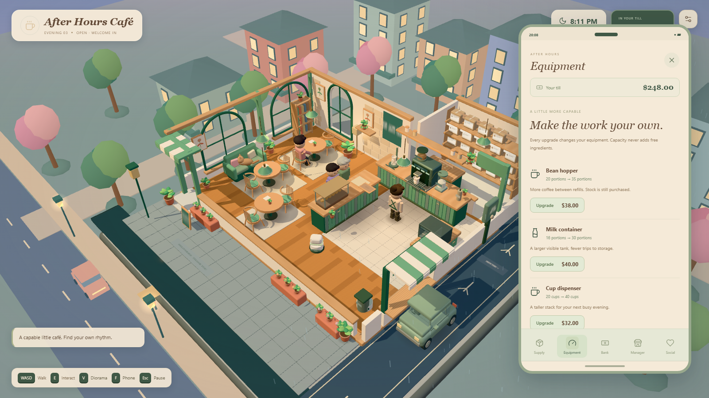
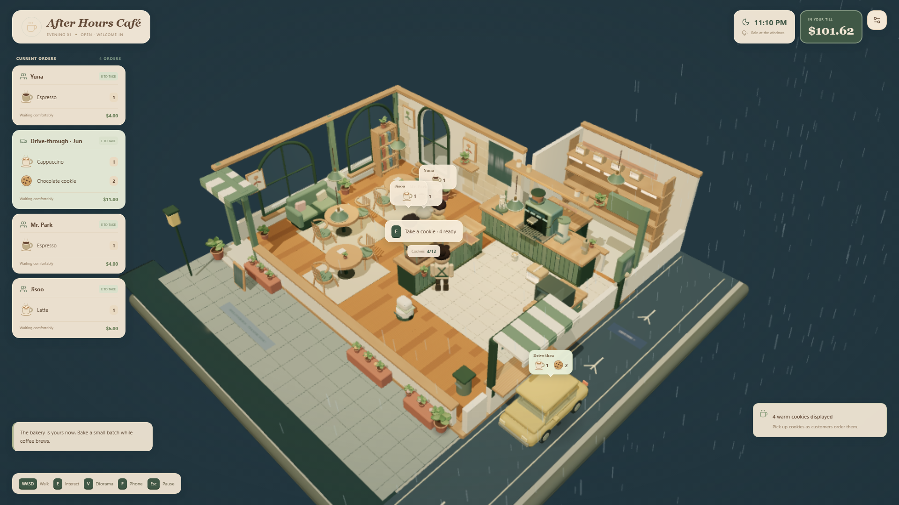
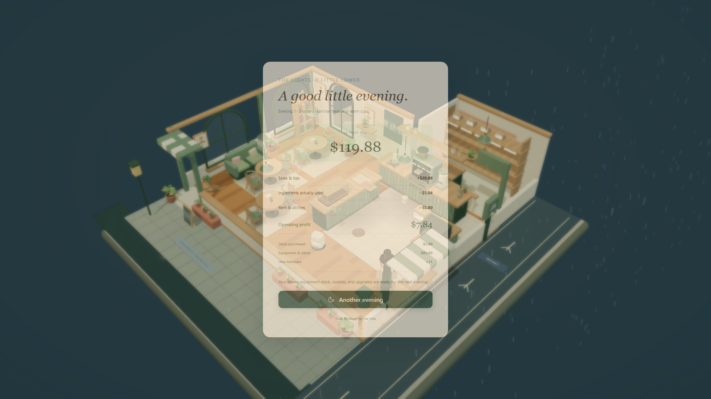

<p align="center"></p>

<p align="center"><a href="https://after-hours-cafe.upbeat-badge-4829.chatgpt.site"><b>PLAY THE PUBLIC GAME</b></a> · <a href="GAME_DESIGN.md">Design notebook</a> · <a href="docs/ARCHITECTURE.md">Architecture</a> · <a href="VALIDATION.md">Validation</a></p>

# After Hours Café · 3.1

**A little café. A real till. One good evening at a time.**

A living miniature café about keeping coffee flowing, baking warm cookies, restocking the bar, and investing your earnings. Warm oak, rounded sage woodwork, cream tiles, arched windows, soft toy characters, and a kitchen-side drive-through give the business its own place. A rainy Korean-inspired diorama becomes a first-person café with one key. Both views share the same player, real items, customers, machines, and money.

The evening now continues beyond your windows: a pastel neighborhood, blossom trees, lit apartments, pedestrians with umbrellas, passing traffic and soft streetlamps. Richer greens, terracotta and golden wood sit under warmer lighting. First-person strafing follows the camera correctly; WASD and arrow keys share the same movement.

[Play online](https://after-hours-cafe.upbeat-badge-4829.chatgpt.site) — public access, no game account required. Saves stay in your browser.



## A miniature world that works

Seating and the entrance are on the left. Coffee, cookies, handoff, and the drive-through window are on the right. The stockroom sits directly behind the kitchen. Cars approach along the outside wall, stop beside the sliding window, and leave through the exterior lane.

Customers take their orders back to the tables. Make their coffee, serve them there, or let Bomi carry the products along the clear aisles. Scroll over the café for a small diorama zoom; press V for the complete interior, including walls and ceiling.

<table><tr><td width="50%"><b>A roadside drive-through</b></td><td><b>Storage attached to the working kitchen</b></td></tr></table>

[Art direction and layout notes](docs/ART_DIRECTION.md) explain the redesign, central coordinates, save migration, and visual decisions.

## Stock → brew → bake → serve → grow

| A readable coffee loop | A connected business | A place that becomes yours |
| --- | --- | --- |
| Pick up a cup, place it beneath the spout, choose a recipe, watch it fill, collect, and serve. Learn ingredient differences without managing a manual portafilter. | Paid supply deliveries become physical boxes. Partial refills preserve leftovers. Orders pay once, after every item is delivered. | Upgrade nine equipment categories, expand your serving tray, hire Bomi, customize colors and décor, and keep your progress for another night. |

<table>
<tr><td width="50%"><b>Two views, one café</b><br/>V changes your perspective; E keeps the same interaction.</td><td width="50%"><b>Learn while playing</b><br/>Espresso, americano, latte, cappuccino, then vanilla and flat white.</td></tr>
<tr><td><b>A supply chain you can touch</b><br/>Truck → box → shelf → hopper, tank, dispenser, or dough station.</td><td><b>Invest in the next evening</b><br/>More capacity, faster production, larger batches, and a serving robot.</td></tr>
<tr><td><b>Bake while the coffee brews</b><br/>Prepare a dough tray, start the oven, collect, display, and sell.</td><td><b>Feel the money you earn</b><br/>Bank transactions and closing reports explain where the cash went.</td></tr>
</table>

## What is playable

- Four starting coffees; bakery after two lifetime orders; vanilla and flat white after six. One gentle next-action prompt introduces the systems.
- Indoor guests and a drive-through with compact cars, sedans, SUVs, and vans. Multi-item receipts support partial delivery and reject wrong products.
- A single carried object: cup, drink, stock box, serving tray, baking tray, or trash. G safely places it down for later collection.
- Physical supply boxes, quantity-preserving refills, milk/bean levels, shrinking cup stacks, an animated machine, steam, oven door, cookies, truck, and cars.
- Bomi delivers products you actually prepared to indoor customers and returns to the dock. Mochi cleans actual spills. Milo wanders, naps, and accepts a hello.
- Supply, Equipment, Bank, Café Manager, and CafeGram phone apps. Real transactions, editable menu prices, regulars, event-based posts, demand changes, customization, décor, and café ownership.
- Procedural grinder, pump, steam, cup, refill, oven, delivery, car, footstep, cleanup, and payment sounds; soft music and window-sensitive rain.
- Twelve-minute shifts, forgiving queues, closing after the last accepted orders, versioned browser saves, and preserved supplies/upgrades into the next shift.

## Play locally

Requires **Node.js 22.12 or newer**. No API keys, accounts, or environment variables are needed.

```sh
npm ci
npm run dev
```

Open the localhost URL printed by Vite. For the compiled release:

```sh
npm run build
npm run preview
```

Serve `dist/` over HTTP; opening `index.html` through `file://` does not load the game correctly.

| Control | Action |
| --- | --- |
| WASD / arrow keys | Walk relative to the camera |
| E | Interact with the nearby prompt |
| V | Diorama ↔ first person |
| Mouse / click café | First-person look / capture mouse |
| Mouse wheel over café | Small diorama zoom |
| F | Business phone |
| Tab | Equipment app |
| R | Café Manager app |
| G | Safely put down the carried object |
| Esc / Q | Close menu, release mouse, or pause |
| Backtick | Development controls, available only in `npm run dev` |

The phone keeps production running. Pause, Help, Settings, and a hidden browser tab stop simulation timers. Menus release the mouse in first person.

## Setup for contributors

```sh
npm test
npm run typecheck
npm run build
```

53 meaningful rule, layout, and save tests cover conservation of stock, partial orders, duplicate payment, deliveries, baking, robots, cars, expenses, camera state, closing, migration, station reachability, clear serving routes, and camera-relative movement. [Validation](VALIDATION.md) describes the browser playthroughs and their fixtures. GitHub Actions is configured for Node 22, locked installation, tests, and a downloadable production artifact; account-level runner availability can affect cloud runs independently of the game.

Recipes, prices, pack sizes, equipment capacity, and timings are centralized in [`src/data/operations.ts`](src/data/operations.ts). Room coordinates live in [`src/data/layout.ts`](src/data/layout.ts). Personalize the café through the phone; edit the world palette in `src/game/art.tsx` and matching UI in `src/styles/miniature.css`. See [Contributing](CONTRIBUTING.md).

**Scope:** this is a browser café-management prototype with a stylized procedural world. Its automatic machine teaches recipes and workflow; it does not simulate manual espresso extraction, commercial food safety, or real currency. No multiplayer, cloud saves, Steam integration, or external services are required. Touch controls and narrow phone layouts are available; desktop keyboard/mouse is the primary experience.

Made by **[Abdul Mannan](https://github.com/MannanBabar16)** · Unity Game Developer Bruv. · [LinkedIn](https://www.linkedin.com/in/abdulmannanbabar)
